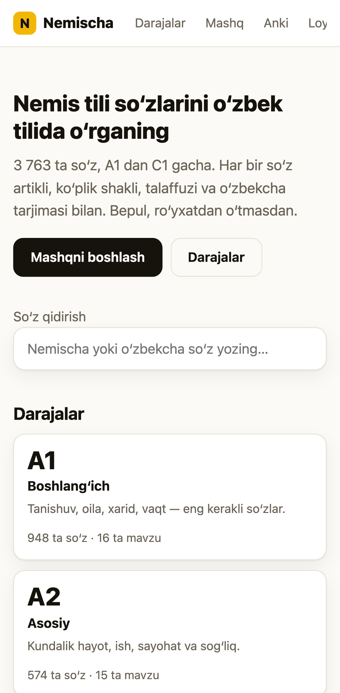
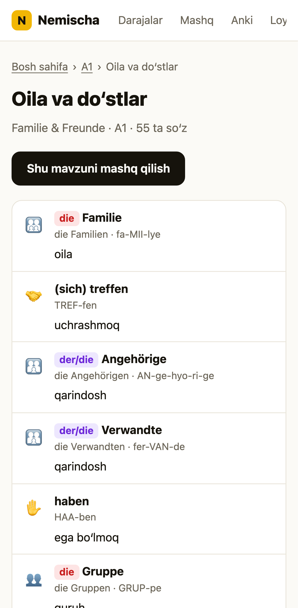
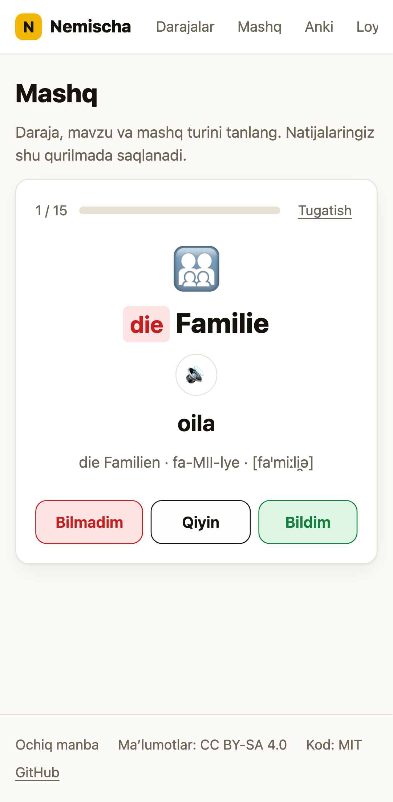

# Nemischa

**Nemis tili lugʻati — oʻzbek tilida.** A1 dan C1 gacha 3 763 ta soʻz: artikl, koʻplik shakli,
talaffuz va oʻzbekcha tarjima. Bepul, ochiq, roʻyxatdan oʻtmasdan.

**An open German–Uzbek vocabulary** for levels A1–C1: 3,763 words with article, plural,
pronunciation and Uzbek translation, plus a spaced-repetition trainer and Anki decks.

Sayt / Site: <https://temurturayev.github.io/nemischa/>

<p>
  
  
  
</p>

## Oʻzbekcha

- **Lugʻat** — soʻzlar daraja va mavzular boʻyicha tartiblangan, har bir soʻzning oʻz sahifasi bor.
- **Mashq** — kartochkalar, test va der/die/das mashqi. Sayt soʻzni unutish arafasida qayta soʻraydi.
- **Anki** — har bir daraja uchun tayyor toʻplam.
- **Ochiq maʼlumotlar** — `data/` papkasidagi JSON va CSV fayllardan oʻz loyihangizda foydalaning.

Tarjimalar sunʼiy intellekt yordamida tayyorlangan va hali inson tomonidan toʻliq tekshirilmagan.
Xato topsangiz, [xabar bering](https://github.com/TemurTurayev/nemischa/issues/new) — tuzatamiz.

## English

### What is in the repository

| Path | What it is |
|---|---|
| `data/` | The published dataset: one JSON file per level, `nemischa.csv`, `stats.json` |
| `pipeline/` | Python pipeline that cleans, deduplicates and verifies the raw word lists |
| `site/` | Static site (Astro) with the dictionary pages and the trainer |
| `site/public/anki/` | Anki decks, generated by `make anki` |

### Dataset

Each entry looks like this:

```json
{
  "id": "haus",
  "de": "Haus",
  "article": "das",
  "plural": "⸚-er",
  "plural_form": "Häuser",
  "pos": "noun",
  "ipa": "haʊ̯s",
  "uz_respell": "HAUS",
  "uz": "uy",
  "en": "house",
  "emoji": "🏠",
  "subgroup": "Wohnen"
}
```

- `plural` is the textbook marker (`-e`, `⸚-er` where `⸚` means an umlaut, `Sg.`, `Pl.`);
  `plural_form` is the full nominative plural when one exists.
- `uz_respell` shows how the German word sounds, written with Uzbek letters, stress in capitals.
- Uzbek text uses `ʻ` (U+02BB) in oʻ/gʻ and `ʼ` (U+02BC) for the glottal stop.

How reliable is it?

- **Nouns** (2,044): gender and plural are checked against Wiktionary through
  [german-nouns](https://github.com/gambolputty/german-nouns). About 96 % of the articles are
  confirmed; the rest are compounds the dictionary does not list.
  The full report is in `pipeline/reports/qa.json`.
- **Translations and pronunciation** were generated with AI assistance and spot-checked.
  They have not been fully proofread by a human yet. Corrections are welcome.
- Every manual correction is recorded with its reason in `pipeline/overrides.json`.
- A word that appears at several levels is kept once, at its lowest level; further meanings
  from the repeats are appended to it (320 cases, listed in the QA report).
- Entry ids are stable: they are recorded in `pipeline/ids.json` and never reassigned.

### Development

Requirements: [uv](https://docs.astral.sh/uv/) and Node.js 22.12 or newer.

```sh
make data   # raw lists -> data/*.json and the QA report
make anki   # data -> Anki decks
make dev    # site at http://localhost:4321/nemischa/
make test   # unit tests (pipeline and site)
make e2e    # browser tests against the built site
```

To deploy somewhere other than GitHub Pages, set the address at build time:

```sh
SITE_URL=https://example.org SITE_BASE=/ npm run build
```

### License

- Code: [MIT](LICENSE)
- Data: [CC BY-SA 4.0](data/LICENSE)
